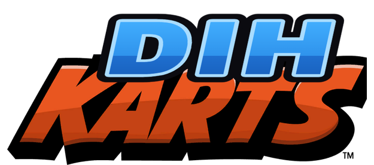
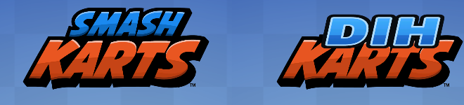
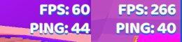
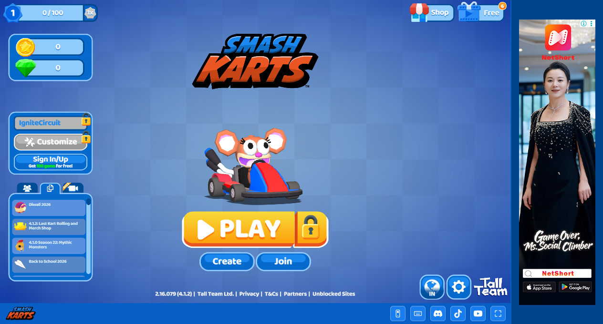
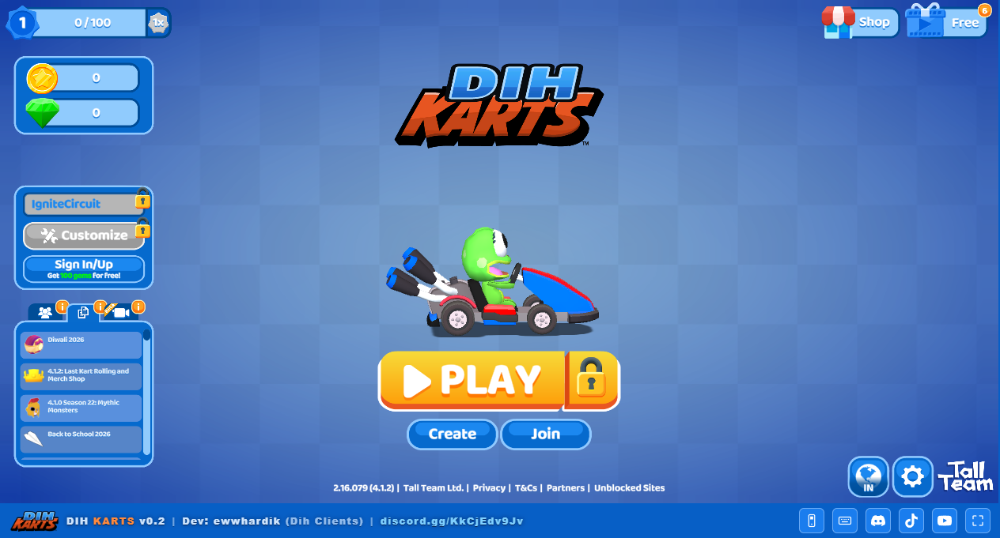
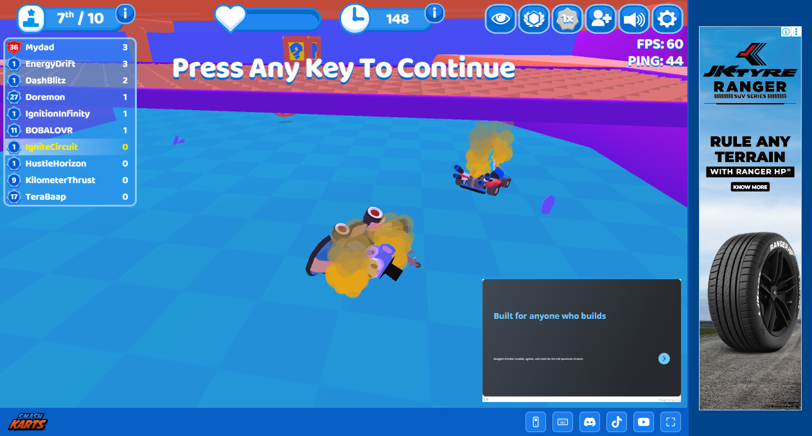
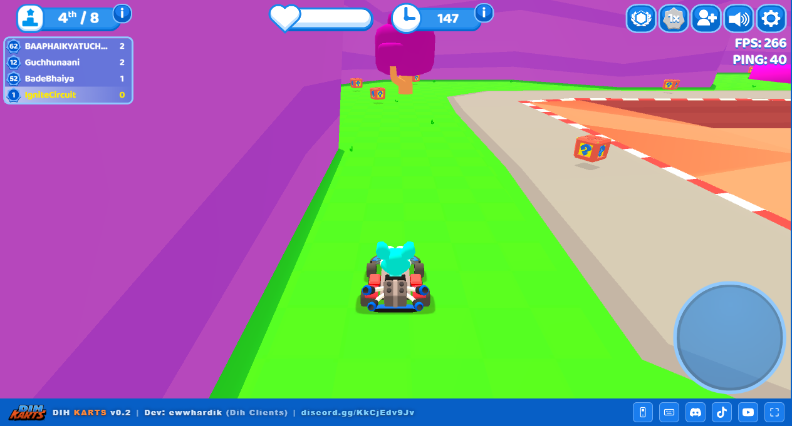

<div align="center">
  
  <h1>Dih Karts</h1>
  <p><strong>A fast, uncapped, ad-free desktop client for SmashKarts.io — by <a href="https://github.com/ewwhardik">ewwhardik</a> (Dih Clients)</strong></p>
  <p>
    <a href="https://github.com/ewwhardik/dih-karts/releases/latest"><strong>Download</strong></a> •
    <a href="https://ewwhardik.github.io/dih-karts/"><strong>Website</strong></a> •
    <a href="https://discord.gg/KkCjEdv9Jv"><strong>Join the Discord</strong></a>
  </p>
</div>

> Unofficial fan-made client. Not affiliated with or endorsed by Tall Team. It loads the real `smashkarts.io`; nothing is hosted or re-distributed except the replacement logo patch.

## Proof

**In-game logo — original (left) vs Dih Karts (right):**



**In-game FPS counter — browser (left) vs Dih Karts (right):**



**Before (ads, 60 FPS cap) vs Dih Karts:**

| Before | Dih Karts |
| :---: | :---: |
|  |  |
|  |  |

## Features

- **Uncapped FPS** — removes Chromium's frame limit and VSync, keeps the GPU/renderer un-throttled. Measured 177–266 FPS on a 60 Hz monitor in real matches.
- **The game's own FPS counter shows the real number.** The game clamps its counter to `min(fps, 60)`; the client patches that single constant in the WebAssembly as it loads (no game files are modified on disk). The counter looks exactly like the original.
- **Dih Karts logo, inside the game** — the in-game menu logo, loading logo and bar logo are replaced (the game's atlas texture is patched on upload). A signature check makes the patch skip itself if the game ships a different atlas.
- **Ad blocker** — Ghostery engine with EasyList, EasyPrivacy and Fanboy Annoyance, cached on disk. The ad side-panel is removed and the game stretches to the full window.
- **Networking** — DNS-over-HTTPS (Cloudflare/Google), QUIC, connection pre-warming to the game and CDN, no background pings/networking. (These speed up connection setup; they cannot change the game's server latency.)
- **Frame limiter (F6)** — Unlimited / 240 / 165 / 144 / 120 / 60, for battery or frame pacing.
- **Render scale (F7)** — 1.0× / 0.75× / 0.5× / 1.25× for more FPS on weak GPUs or sharper image.
- **Fullscreen (F11)**, remembers window size, position and fullscreen state.
- **Dev watermark** in the bottom bar (toggle with F8) — `Dev: ewwhardik (Dih Clients)` and the Discord link.
- All SmashKarts Discord buttons point to the Dih Clients server.
- **Smaller** — trimmed Electron build (~112 MB zip), single-instance, no service worker serving stale builds.

## Hotkeys

| Key | Action |
| :--- | :--- |
| `F11` | Fullscreen |
| `F5` | Reload |
| `F6` | Cycle FPS limit |
| `F7` | Cycle render scale |
| `F8` | Toggle watermark |
| `Ctrl+Shift+I` | DevTools |

## Install

1. Download `DihKarts-win-x64.zip` from the [latest release](https://github.com/ewwhardik/dih-karts/releases/latest).
2. Extract anywhere and run `Dih Karts.exe`.

## Build from source

```bash
npm install
npm start                 # run
node tools/package.js     # trimmed portable build + zip in dist/
```

`tools/` also contains the logo pipeline (`makelogo.js` → `buildpatch.mjs`) that renders the logo and encodes it as DXT5 blocks for the game's atlas.

## How it works

The game is a Unity WebGL build. The client intercepts the framework and `.wasm` downloads, patches the main-loop timing and the FPS-counter clamp, and swaps the logo blocks when the UI atlas is uploaded to the GPU. Everything happens in memory; the original files are never changed.

## License

Source code © 2026 ewwhardik / Dih Clients. SmashKarts and its artwork belong to Tall Team Ltd.
